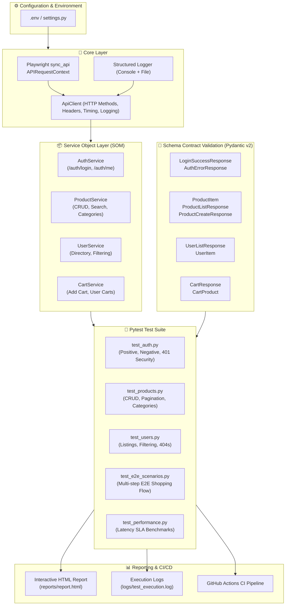

# 🚀 Playwright Python API Automation Testing Framework

[](https://www.python.org/)
[](https://playwright.dev/python/docs/api-testing)
[](https://docs.pytest.org/)
[](https://docs.pydantic.dev/)
[](.github/workflows/api_tests.yml)
[](LICENSE)

An enterprise-grade, high-performance API automation testing framework built with **Playwright Python** (`APIRequestContext`), **Pytest**, and **Pydantic v2**.

Targeted against the modern RESTful platform [DummyJSON](https://dummyjson.com), this project demonstrates modern SQA best practices including **Service Object Model (SOM)** architecture, strict **Contract/Schema Validation**, **JWT Authentication flows**, **Full CRUD lifecycle testing**, **End-to-End E-Commerce workflows**, **Performance SLA assertions**, and **Continuous Integration (CI/CD)** with interactive HTML test reports.

---

## 🌟 Key Highlights & Engineering Features

- **⚡ Native Playwright APIRequestContext**: Uses Playwright's lightweight, lightning-fast request context without spawning heavy browser instances—ideal for both standalone API testing and unified hybrid UI/API test automation.
- **🏗️ Service Object Model (SOM) Architecture**: Separation of concerns isolating HTTP mechanics (`ApiClient`), domain business logic (`AuthService`, `ProductService`, `UserService`, `CartService`), and declarative test definitions.
- **🛡️ Strict Schema & Contract Validation**: Powered by **Pydantic v2** models to validate API response payloads, field types, required properties, and nested structures at runtime.
- **🔐 JWT Authentication & Authorization Testing**: Full authentication lifecycle tests covering token generation, protected endpoint access (`/auth/me`), invalid token rejection, and unauthorized (401) security checks.
- **🔄 Complete CRUD & Boundary Testing**: Create, Read, Update (PUT/PATCH), and Delete verification, alongside edge cases, invalid IDs (404), empty inputs (400), and query pagination.
- **🛒 Real-world E2E Multi-step User Scenarios**: End-to-end user workflows linking login -> profile verification -> catalog search -> cart addition -> price calculation assertions.
- **⏱️ Performance & Latency SLA Assertions**: Automated benchmarks ensuring response times adhere to strict Service Level Agreements (< 1500ms).
- **📊 Interactive HTML Test Reporting**: Generates rich self-contained HTML test reports (`reports/report.html`) complete with timings, failure stack traces, and environment metadata.
- **🤖 GitHub Actions CI/CD Pipeline**: Automated test runs on every push and pull request with automated report artifact archiving.

---

## 🏛️ Framework Architecture



---

## 📁 Repository Directory Structure

```text
playwright-api-testing-framework/
├── .github/
│   └── workflows/
│       └── api_tests.yml          # GitHub Actions CI/CD automated workflow
├── config/
│   ├── __init__.py
│   └── settings.py                # Environment configuration loader (pydantic/dotenv)
├── core/
│   ├── __init__.py
│   ├── api_client.py              # Playwright APIRequestContext wrapper with latency tracking
│   └── logger.py                  # Structured console and file logger
├── schemas/                       # Pydantic v2 schema contract models
│   ├── __init__.py
│   ├── auth_schemas.py            # Authentication & Token schemas
│   ├── product_schemas.py         # Product & CRUD response schemas
│   ├── user_schemas.py            # User list & detail schemas
│   └── cart_schemas.py            # Shopping cart & calculation schemas
├── services/                      # Service Object Model (SOM) business controllers
│   ├── __init__.py
│   ├── auth_service.py            # /auth endpoints controller
│   ├── product_service.py         # /products endpoints controller
│   ├── user_service.py            # /users endpoints controller
│   └── cart_service.py            # /carts endpoints controller
├── utils/
│   ├── __init__.py
│   └── data_generator.py          # Dynamic test data & payload generator
├── tests/                         # Test suites
│   ├── __init__.py
│   ├── conftest.py                # Pytest fixtures (contexts, clients, auth tokens)
│   ├── test_auth.py               # Authentication & token verification tests
│   ├── test_products.py           # Product catalog, CRUD, and category tests
│   ├── test_users.py              # User directory & query filter tests
│   ├── test_e2e_scenarios.py      # E2E shopping journey workflow tests
│   └── test_performance.py       # Response latency SLA tests
├── reports/                       # Generated HTML test execution reports
├── logs/                          # Persistent test execution logs
├── .env.example                   # Environment variables template
├── .gitignore                     # Git ignore rules for Python & Playwright
├── pytest.ini                     # Pytest configuration, CLI logging, and markers
├── requirements.txt               # Project Python dependencies
└── README.md                      # Framework documentation
```

---

## 🛠️ Setup & Installation

### 1. Prerequisites
- **Python 3.10+**
- **Git**

### 2. Clone Repository
```bash
git clone https://github.com/TanzimSQA/playwright-api-testing-framework.git
cd playwright-api-testing-framework
```

### 3. Create & Activate Virtual Environment
```bash
# Windows (PowerShell)
python -m venv venv
.\venv\Scripts\Activate.ps1

# Linux / macOS
python3 -m venv venv
source venv/bin/activate
```

### 4. Install Dependencies
```bash
pip install -r requirements.txt
python -m playwright install --with-deps
```

### 5. Configure Environment Variables
Copy `.env.example` to `.env`:
```bash
cp .env.example .env
```
Default parameters are pre-configured to point to [DummyJSON](https://dummyjson.com).

---

## 🧪 Test Execution Guide

### Run Full Test Suite with HTML Report
```bash
pytest
```
*An interactive HTML report will be generated at `reports/report.html`.*

### Run Specific Test Categories by Marker
```bash
# Smoke tests (critical path verification)
pytest -m smoke

# Authentication and security tests
pytest -m auth

# Product catalog & CRUD operations
pytest -m products

# End-to-End multi-step user scenarios
pytest -m e2e

# Performance SLA benchmark tests
pytest -m performance

# Full regression suite
pytest -m regression
```

### Run a Specific Test File
```bash
pytest tests/test_products.py -v
pytest tests/test_auth.py -v
```

---

## 📊 Comprehensive Test Coverage Matrix

| Category | Endpoint | HTTP Method | Test Scenario | Expected Outcome |
| :--- | :--- | :--- | :--- | :--- |
| **Auth** | `/auth/login` | `POST` | Valid credentials login | `200 OK`, JWT access token generated, Schema validated |
| **Auth** | `/auth/login` | `POST` | Invalid password login | `400 Bad Request`, Error message "Invalid credentials" |
| **Auth** | `/auth/login` | `POST` | Non-existent user login | `400 Bad Request`, Error message returned |
| **Auth** | `/auth/me` | `GET` | Authenticated profile retrieval | `200 OK`, Current user data matches session |
| **Security**| `/auth/me` | `GET` | Missing authorization token | `401 Unauthorized`, Access token required message |
| **Security**| `/auth/me` | `GET` | Malformed/invalid Bearer token | `401 Unauthorized`, Rejected |
| **Products**| `/products` | `GET` | Pagination parameters (`limit`, `skip`) | `200 OK`, Exact limit returned, Schema validated |
| **Products**| `/products/{id}`| `GET` | Fetch existing product by ID | `200 OK`, Accurate product details returned |
| **Products**| `/products/{id}`| `GET` | Fetch non-existent product (`id=999999`) | `404 Not Found`, Message matches |
| **Products**| `/products/search` | `GET` | Search products with query parameter | `200 OK`, Matching products list returned |
| **Products**| `/products/categories` | `GET` | Fetch full list of categories | `200 OK`, Non-empty categories array |
| **Products**| `/products/category/{cat}` | `GET` | Filter products by category | `200 OK`, All items belong to requested category |
| **Products**| `/products/add` | `POST` | Create new product with dynamic payload | `201 Created` / `200 OK`, Generated ID, Data verified |
| **Products**| `/products/{id}` | `PUT` | Full resource update | `200 OK`, Updated attributes reflected |
| **Products**| `/products/{id}` | `PATCH` | Partial resource update | `200 OK`, Only specified field updated |
| **Products**| `/products/{id}` | `DELETE` | Remove existing product | `200 OK`, `isDeleted: True` confirmation |
| **Users** | `/users` | `GET` | Retrieve user directory | `200 OK`, User schema validated |
| **Users** | `/users/{id}` | `GET` | Retrieve single user profile | `200 OK`, Accurate user details |
| **Users** | `/users/filter` | `GET` | Filter users by attribute (e.g. `gender`) | `200 OK`, All returned users match filter |
| **E2E** | Multi-endpoint | Multiple | Login -> Verify -> Search -> Add to Cart | Seamless multi-step transactional integrity verified |
| **SLA** | Multiple | `GET`/`POST` | Response latency benchmark | Duration <= 1500ms SLA threshold |

---

## 📈 HTML Report Sample

When tests are executed, `pytest-html` automatically compiles an interactive report:
- **Location**: `reports/report.html`
- **Features**: Filter by Passed/Failed/Skipped, execution timeline, request duration statistics, error stack traces, and environment details.

---

## 🔄 CI/CD Pipeline (GitHub Actions)

This project includes a production-ready GitHub Actions workflow (`.github/workflows/api_tests.yml`):
- Runs automatically on every **Push** and **Pull Request** to `main`.
- Can be manually triggered via **Workflow Dispatch**.
- Automatically sets up Python, installs dependencies, executes test suites, and archives the HTML report as an artifact accessible directly from GitHub.

---

## 👨‍💻 Author

**Tanzim SQA**  
- GitHub: [@TanzimSQA](https://github.com/TanzimSQA)
- Email: [tanzimsqa@gmail.com](mailto:tanzimsqa@gmail.com)

---

## 📄 License

This project is licensed under the MIT License - see the [LICENSE](LICENSE) file for details.
