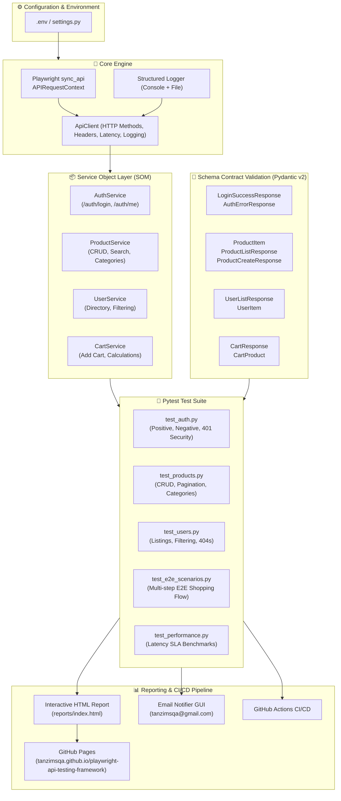

# Playwright Python API Automation Testing Framework

[](https://github.com/TanzimSQA/playwright-api-testing-framework/actions/workflows/api_tests.yml)
[](https://tanzimsqa.github.io/playwright-api-testing-framework/)
[](https://github.com/TanzimSQA/playwright-api-testing-framework/actions)
[-blueviolet?style=flat&logo=googlechrome&logoColor=white)](https://tanzimsqa.github.io/)
[](https://github.com/TanzimSQA)
[](https://www.python.org/)
[](https://playwright.dev/python/docs/api-testing)
[](https://docs.pytest.org/)
[](https://docs.pydantic.dev/)
[](LICENSE)

An enterprise-grade, high-performance REST API test automation framework targeting [DummyJSON](https://dummyjson.com), developed with **Python**, **Playwright** (`APIRequestContext`), **Pytest**, and **Pydantic v2**, following the industry-standard **Service Object Model (SOM)** architecture pattern.

> 🌐 **Author Portfolio**: [Tanzim Rahman (TanzimSQA) - Software Quality Assurance Engineer Portfolio](https://tanzimsqa.github.io/)  
> 📊 **Live Interactive HTML Test Report**: [https://tanzimsqa.github.io/playwright-api-testing-framework/](https://tanzimsqa.github.io/playwright-api-testing-framework/)  
> ⏰ **Automated Schedule**: Runs automatically every day at **10:00 AM Bangladesh Standard Time (BST, UTC+6)** / `04:00 UTC`.  
> 📧 **Executive Email Alerts**: Automatically dispatches a responsive HTML KPI metrics report to QA Lead (`tanzimsqa@gmail.com`) upon test completion.

---

## 🚀 Key Framework Features

- **⚡ Native Playwright APIRequestContext**: Uses Playwright's native HTTP execution engine—delivering fast, lightweight API execution without browser overhead, and ready for hybrid UI/API test scenarios.
- **🏗️ Service Object Model (SOM) Architecture**: Clean separation between low-level HTTP transport (`ApiClient`), domain business services (`AuthService`, `ProductService`, `UserService`, `CartService`), and test cases.
- **🛡️ Strict Pydantic v2 Contract Validation**: Deep runtime schema verification of response objects, data types, required attributes, and nested payload structures.
- **🔐 JWT Authentication & Security Tests**:
  - Valid user login and Bearer token acquisition.
  - Authenticated user profile retrieval (`/auth/me`).
  - Unauthorized access checks (401 Unauthorized for missing or malformed tokens).
  - Invalid credentials error validation (400 Bad Request).
- **🔄 Full CRUD & Query Testing**:
  - Create product with dynamic unique payloads (`POST /products/add`).
  - Read product details by ID and paginated listings with `limit` and `skip`.
  - Update product full resource (`PUT /products/{id}`) and partial fields (`PATCH /products/{id}`).
  - Delete product and verify confirmation flag (`DELETE /products/{id}`).
  - Search products with keyword filtering (`/products/search?q=phone`).
  - Category retrieval and category-based filtering (`/products/category/smartphones`).
- **🛒 End-to-End E-Commerce Workflow**:
  - Full transactional user journey: Login -> Verify user session -> Search catalog -> Add item to cart -> Validate quantity, subtotal, and discount calculations.
- **⏱️ Performance & Latency SLA Assertions**: Automated benchmarks ensuring all critical endpoints respond within SLA thresholds (< 1500ms).
- **📊 Interactive GitHub Pages Reporting**: Every test run produces a self-contained HTML dashboard deployed directly to **GitHub Pages**.
- **🤖 GitHub Actions CI/CD with Scheduled Runs**: Runs daily at 10:00 AM BST, on every push and pull request, with automated Pages deployment and email alerts.

---

## 🏛️ Framework Architecture



---

## 📁 Repository Directory Structure

```text
playwright-api-testing-framework/
├── .github/
│   └── workflows/
│       └── api_tests.yml          # GitHub Actions CI/CD workflow (Daily 10:00 AM BST)
├── config/
│   ├── __init__.py
│   └── settings.py                # Environment configuration loader (pydantic/dotenv)
├── core/
│   ├── __init__.py
│   ├── api_client.py              # Playwright APIRequestContext wrapper with latency tracking
│   └── logger.py                  # Structured console and file logger
├── schemas/                       # Pydantic v2 schema contract models
│   ├── __init__.py
│   ├── auth_schemas.py            # Authentication & Token schemas
│   ├── product_schemas.py         # Product & CRUD response schemas
│   ├── user_schemas.py            # User list & detail schemas
│   └── cart_schemas.py            # Shopping cart & calculation schemas
├── services/                      # Service Object Model (SOM) business controllers
│   ├── __init__.py
│   ├── auth_service.py            # /auth endpoints controller
│   ├── product_service.py         # /products endpoints controller
│   ├── user_service.py            # /users endpoints controller
│   └── cart_service.py            # /carts endpoints controller
├── utils/
│   ├── __init__.py
│   ├── data_generator.py          # Dynamic test data generator
│   └── email_notifier.py          # Responsive HTML email notification dispatcher
├── tests/                         # Pytest test suites
│   ├── __init__.py
│   ├── conftest.py                # Pytest fixtures & sessionfinish summary hook
│   ├── test_auth.py               # Authentication & security tests (6 tests)
│   ├── test_products.py           # Product catalog, CRUD, and category tests (13 tests)
│   ├── test_users.py              # User directory & query filter tests (4 tests)
│   ├── test_e2e_scenarios.py      # E2E shopping journey workflow tests (1 test)
│   └── test_performance.py       # Response latency SLA tests (3 tests)
├── reports/
│   ├── index.html                 # Interactive test execution report (GitHub Pages root)
│   └── summary.json               # Test KPI metrics summary
├── logs/                          # Persistent test execution logs
├── .env.example                   # Environment variables template
├── .gitignore                     # Git ignore rules for Python & Playwright
├── pytest.ini                     # Pytest configuration, CLI logging, and markers
├── requirements.txt               # Project Python dependencies
└── README.md                      # Framework documentation
```

---

## 🛠️ Setup & Installation

### 1. Prerequisites
- **Python 3.10+**
- **Git**

### 2. Clone Repository
```bash
git clone https://github.com/TanzimSQA/playwright-api-testing-framework.git
cd playwright-api-testing-framework
```

### 3. Create & Activate Virtual Environment
```bash
# Windows (PowerShell)
python -m venv venv
.\venv\Scripts\Activate.ps1

# Linux / macOS
python3 -m venv venv
source venv/bin/activate
```

### 4. Install Dependencies
```bash
pip install -r requirements.txt
python -m playwright install --with-deps
```

### 5. Configure Environment Variables
Copy `.env.example` to `.env`:
```bash
cp .env.example .env
```
Default parameters are pre-configured to point to [DummyJSON](https://dummyjson.com).

---

## 🧪 Test Execution Guide

### Run Full Test Suite with HTML Report
```bash
pytest
```
*An interactive HTML report will be generated at `reports/index.html`.*

### Run Specific Test Categories by Marker
```bash
# Smoke tests (critical path verification)
pytest -m smoke

# Authentication and security tests
pytest -m auth

# Product catalog & CRUD operations
pytest -m products

# End-to-End multi-step user scenarios
pytest -m e2e

# Performance SLA benchmark tests
pytest -m performance

# Full regression suite
pytest -m regression
```

### Dispatch Email Report Manually
```bash
python utils/email_notifier.py
```

---

## 📊 Comprehensive Test Coverage Matrix

| Category | Endpoint | HTTP Method | Test Scenario | Expected Outcome |
| :--- | :--- | :--- | :--- | :--- |
| **Auth** | `/auth/login` | `POST` | Valid credentials login | `200 OK`, JWT access token generated, Schema validated |
| **Auth** | `/auth/login` | `POST` | Invalid password login | `400 Bad Request`, Error message "Invalid credentials" |
| **Auth** | `/auth/login` | `POST` | Non-existent user login | `400 Bad Request`, Error message returned |
| **Auth** | `/auth/me` | `GET` | Authenticated profile retrieval | `200 OK`, Current user data matches session |
| **Security**| `/auth/me` | `GET` | Missing authorization token | `401 Unauthorized`, Access token required message |
| **Security**| `/auth/me` | `GET` | Malformed/invalid Bearer token | `401 Unauthorized`, Rejected |
| **Products**| `/products` | `GET` | Pagination parameters (`limit`, `skip`) | `200 OK`, Exact limit returned, Schema validated |
| **Products**| `/products/{id}`| `GET` | Fetch existing product by ID | `200 OK`, Accurate product details returned |
| **Products**| `/products/{id}`| `GET` | Fetch non-existent product (`id=999999`) | `404 Not Found`, Message matches |
| **Products**| `/products/search` | `GET` | Search products with query parameter | `200 OK`, Matching products list returned |
| **Products**| `/products/categories` | `GET` | Fetch full list of categories | `200 OK`, Non-empty categories array |
| **Products**| `/products/category/{cat}` | `GET` | Filter products by category | `200 OK`, All items belong to requested category |
| **Products**| `/products/add` | `POST` | Create new product with dynamic payload | `201 Created` / `200 OK`, Generated ID, Data verified |
| **Products**| `/products/{id}` | `PUT` | Full resource update | `200 OK`, Updated attributes reflected |
| **Products**| `/products/{id}` | `PATCH` | Partial resource update | `200 OK`, Only specified field updated |
| **Products**| `/products/{id}` | `DELETE` | Remove existing product | `200 OK`, `isDeleted: True` confirmation |
| **Users** | `/users` | `GET` | Retrieve user directory | `200 OK`, User schema validated |
| **Users** | `/users/{id}` | `GET` | Retrieve single user profile | `200 OK`, Accurate user details |
| **Users** | `/users/filter` | `GET` | Filter users by attribute (e.g. `gender`) | `200 OK`, All returned users match filter |
| **E2E** | Multi-endpoint | Multiple | Login -> Verify -> Search -> Add to Cart | Seamless multi-step transactional integrity verified |
| **SLA** | Multiple | `GET`/`POST` | Response latency benchmark | Duration <= 1500ms SLA threshold |

---

## 📈 HTML Report & Email Alerts

### 1. Interactive GitHub Pages Dashboard
The automated test suite deploys live HTML execution reports to GitHub Pages at:
👉 **[https://tanzimsqa.github.io/playwright-api-testing-framework/](https://tanzimsqa.github.io/playwright-api-testing-framework/)**

### 2. Responsive Email Report GUI
Every test execution can dispatch a responsive HTML email report directly to the QA Lead (`tanzimsqa@gmail.com`) containing:
- Health status badge (`ALL API TESTS PASSED (100% HEALTH)`).
- Executive KPI cards: Total tests, passed count, failed count, pass rate, and execution duration.
- Per-suite breakdown with pass/fail counts.
- Direct links to the GitHub Pages report and GitHub Actions run.

---

## 🔄 CI/CD Pipeline (GitHub Actions)

This project features an automated GitHub Actions pipeline (`.github/workflows/api_tests.yml`):
- **Schedule**: Automatically runs everyday at **10:00 AM BST** (`04:00 UTC`).
- **Triggers**: Also runs on every **Push** and **Pull Request** to `main`, plus manual **Workflow Dispatch**.
- **Automated Deployment**: Automatically publishes the HTML report to **GitHub Pages**.
- **Email Notifications**: Automatically alerts the team via SMTP email.

---

## 👨‍💻 Author & Official Profiles

**Tanzim Rahman (TanzimSQA)**  
*Software Quality Assurance (SQA) Engineer at Koy Jabo*  
- 🌐 **Official Portfolio**: [Tanzim Rahman (TanzimSQA) - Software Quality Assurance Engineer Portfolio](https://tanzimsqa.github.io/)  
- 💼 **LinkedIn**: [https://www.linkedin.com/in/tanzimsqa/](https://www.linkedin.com/in/tanzimsqa/)  
- 🐙 **GitHub**: [@TanzimSQA](https://github.com/TanzimSQA)  
- 📘 **Facebook**: [https://www.facebook.com/tanzim.rahman.sqa/](https://www.facebook.com/tanzim.rahman.sqa/)  
- 📸 **Instagram**: [https://www.instagram.com/tanzim.sqa](https://www.instagram.com/tanzim.sqa)  
- 📧 **Email**: [tanzimsqa@gmail.com](mailto:tanzimsqa@gmail.com)  
- 📍 **Location**: Dhaka, Bangladesh  

<sub>
  <b>Search & Entity Keywords:</b> <code>tanzim</code> • <code>tanzim sqa</code> • <code>tanzimsqa</code> • <code>tanzim rahman</code> • <code>Tanzim Rahman SQA</code> • <code>SQA Engineer at Koy Jabo</code> • <code>SDET</code> • <code>Playwright</code> • <code>Python</code> • <code>Postman</code> • <code>API Testing</code> • <code>JMeter</code> • <code>Koy Jabo</code>
</sub>

---

## 📄 License

This project is licensed under the MIT License - see the [LICENSE](LICENSE) file for details.
